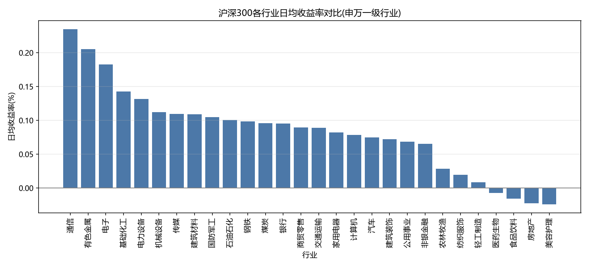
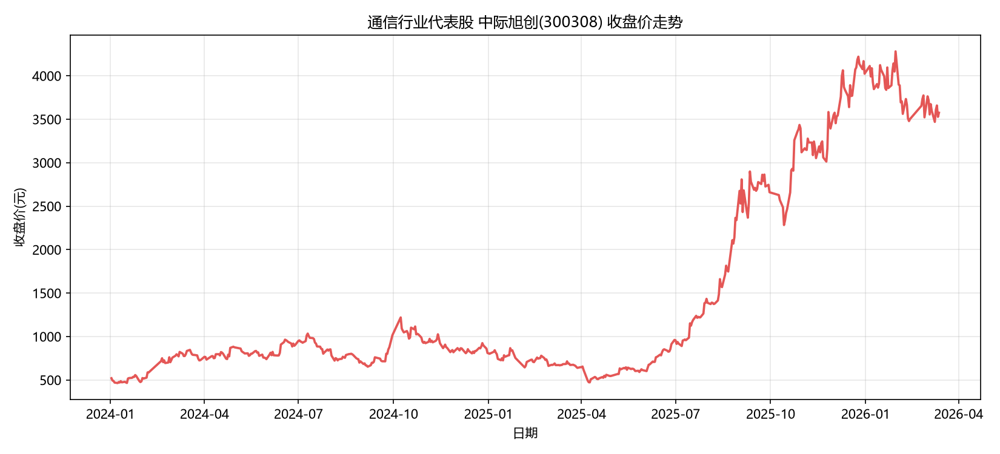

# 沪深300指数历史数据清洗与探索性分析（EDA）

基于 Python + Pandas 的**多表关联**数据清洗与**行业维度**分析项目：对 300 只沪深300成分股、15.8 万行历史行情数据完成清洗、关联与多维聚合，并输出可视化结论。


---

## 一、项目背景

沪深300是A股最具代表性的宽基指数。本项目的目标是回答一个业务问题：

> **不同行业板块的收益与风险特征是否存在系统性差异？哪些板块属于"高风险低回报"，哪些属于"低风险稳回报"？**

为回答这个问题，需要把**只有股票代码的行情数据**补全行业属性，再从行业维度做收益与波动的交叉对比。项目重点不在于预测走势，而在于**数据清洗的严谨性**与**多维分析的呈现方式**。

---

## 二、数据说明

| 文件 | 角色 | 规模 | 主要字段 |
| --- | --- | --- | --- |
| `data/stock_data.csv` | **事实表** | 158,090 行 × 300 只股票 | 股票代码、日期、开盘、收盘、最高、最低、成交量、成交额、振幅、涨跌额、换手率、涨跌幅 |
| `data/hs300_stock_list.csv` | 原始名单 | 300 行 × 3 列 | updateDate、code、code_name |
| `data/industry.csv` | **维度表** | 300 行 × 3 列 | stock_code、stock_name、industry |

- **时间跨度**：2024-01-02 ~ 2026-03-13（约 22 个月，529 个交易日）
- **行业覆盖**：28 个申万一级行业

> **关于行业维度表**：原始名单表只有代码、名称、更新日期三列，**不含行业字段**。由于行业是本项目核心分析维度，故通过 `akshare` 的**申万一级行业成分股接口**（`sw_index_first_info` + `index_component_sw`）拉取官方分类，整理出 `industry.csv` 作为维度表，与行情事实表通过股票代码关联。申万分类是国内券商研究的主流口径，不同分类标准（中信、证监会）下个别股票的归属会存在差异。生成脚本见 `_gen_industry.py`。

---

## 三、目录结构

```
.
├── eda_hs300.py                  # 主脚本：清洗 → 关联 → 聚合 → 可视化（80 行）
├── _gen_industry.py              # 行业维度表生成器（从申万官方接口拉取，需 akshare + 联网）
├── requirements.txt
├── README.md
├── data/
│   ├── stock_data.csv            # 事实表：行情数据
│   ├── hs300_stock_list.csv      # 原始成分股名单
│   └── industry.csv              # 维度表：行业归属
├── chart1_行业收益率对比.png       # 图1：行业日均收益率
└── chart2_代表股走势.png          # 图2：通信行业代表股走势
```

---

## 四、核心结论

### 图1：各行业日均收益率对比



### 图2：通信行业代表股（中际旭创 300308）收盘价走势



### 结论一：银行是全场唯一的低波动板块，但风险收益比最优的是有色金属

银行日波动率仅 **0.0138**，为 28 个行业中**最低**，不到最高板块交通运输（0.0363）的 40%。但若以"每单位风险换取的收益"（收益波动比）衡量，**有色金属以 0.0761 居首**，通信 0.0701、银行 0.0692 紧随其后 —— 三者数值接近，达成方式却完全不同：**银行靠压低波动，有色金属靠抬高收益**（日均收益率 0.00206，排第 2）。

### 结论二：传媒是唯一波动率持续上升的板块，银行则持续下降

在**同一口径**下（三年均只取 1—3 月，保证可比），传媒波动率从 2024 年的 **0.0355 升至 2026 年的 0.0474**，是 28 个行业中唯一逐年抬升的；银行则从 0.0129 持续降至 0.0113，风险不断收敛。对照来看，电子三年稳定在 **0.031—0.032** 的高位属"高位持平"，通信（0.0369 → 0.0348 → 0.0363）则基本持平，**并未扩大**。

### 补充观察

美容护理（-0.00024）、房地产（-0.00023）、食品饮料（-0.00016）、医药生物（-0.00007）录得负收益。其中**美容护理最值得警惕**：收益垫底的同时波动率高达 0.0298（第 6 高），属于典型的"高风险低回报"。交通运输则相反——波动率全场最高（0.0363），收益率却仅排中游（0.00089），风险未能换来对等回报。

---

## 五、关键数据处理点

这是本项目的重点，也是面试中最常被追问的部分。

### 1. 主键格式不一致 —— merge 前必须对齐

行情表主键为 `600000`，名单表为 `sh.600000`。直接 `merge` 的**交集为 0 条**，且不会报错。处理方式是切分前缀统一为 6 位纯数字，同时读取时 `dtype` 强制为字符串——否则 `000001` 会被解析成整数 `1`，同样导致匹配失败。

### 2. 缺失值用 ffill 前向填充 —— 而非均值

数据中共 233 个缺失，**并非随机分布**，而是集中在 **23 只个股的 183 个交易日**上，属于**停牌型缺失**。

**判定依据不是推测，而是缺失行本身的特征**：

```
开盘 = 收盘 = 最高 = 最低     ← 四个价格完全相同
振幅 = 0
涨跌额 = 0
成交量 / 成交额 / 换手率 / 涨跌幅 为空
连续多个交易日
```

这是停牌的教科书特征——数据源把 OHLC 填成停牌前的收盘价作为占位，量能字段留空。

不使用均值填充的三个理由：

| 问题 | 业务后果 |
| --- | --- |
| 信息泄露 | 均值基于全期数据计算，等于用未来信息填充过去，构成前视偏差（look-ahead bias） |
| 违背业务语义 | 停牌的真实含义是"价格未变、无成交"，而非"价格等于历史平均"；均值会造出并不存在的中间价 |
| 污染波动率 | 本项目需计算收益率标准差衡量风险，插入均值会人为压低方差，导致**波动率被系统性低估** |

三个实现细节：

- **按股票分组填充**（`groupby('股票代码').ffill()`）。若不分组，某只股票首日缺失会去继承上一只股票的收盘价，形成跨实体串数据。
- **`涨跌幅` 字段填 0 而非 ffill**。停牌当日无成交，且缺失行的 `涨跌额` 本就为 0，收益填 0 有直接证据支撑；用 ffill 则会虚增收益。**同一张表中不同字段需按业务含义分别处理**。
- **量能字段用 ffill 而非填 0，是一个有意识的取舍**。严格来说停牌期间成交量应为 0，ffill 填入的是上一交易日的成交量。此处保留 ffill 是因为：这些字段仅 `成交额` 被用于筛选行业代表股，不参与收益率与波动率计算，且缺失仅占全表 **0.147%**，对结论无影响。若后续需要做量能分析，则应改为填 0。

### 3. 关联后必须校验关联率

`how='left'` 可保证行情不因维度表缺记录而丢失，但代价是**匹配失败时静默产生 NaN 而不报错**。若不校验，可能拿着一张 80% 是"未分类"的表继续聚合，得出全部失真的结论。因此脚本在关联后打印关联率，本项目实测 **100.00%**。

### 4. 去重作为防御性步骤

`drop_duplicates()` 在本数据集上**移除 0 行**——数据本身无重复。该步骤作为流程中的防御性校验保留：重复行会让同一笔成交被统计两次，直接虚增成交量与收益率。

### 5. 两个统计口径上的坑（本项目最初的版本踩过）

这两点不影响"代码能不能跑"，但影响"结论对不对"，属于容易被面试官追问的地方。

**坑一：不要"先算月均、再把各月平均"**

直觉做法是先按 `groupby(['industry','月份'])` 求月均收益，再把 12 个月平均。但**各月交易日数并不相同**（实测 50~115 个股票-交易日），两步平均等于**给"月"等权而非给"天"等权**——短月份被赋予了与长月份相同的权重。

实测偏差：煤炭 **+36.7%**、电力设备 **+21.4%**、基础化工 **+17.8%**，且**足以改变行业排名**。

正确做法是直接对**日收益率**聚合：

```python
sector = df.groupby('industry')['日收益率'].agg(日均收益率='mean', 日波动率='std')
```

这天然就是日加权的，不需要额外写加权逻辑，代码反而更短。

**坑二：跨年份比较必须取相同区间**

数据集截至 **2026-03-13**，因此：

| 年份 | 交易日数 | 月份数 |
| --- | --- | --- |
| 2024 | 242 | 12 |
| 2025 | 243 | 12 |
| 2026 | **44** | **3** |

用 3 个月的标准差去对比 12 个月的标准差**并不公平**——样本量小 5 倍，估计噪声大得多。因此透视表**统一只取 1—3 月**，让三年处于相同区间。

这个修正直接改变了结论：按全年口径看，通信波动率"从 2025 年 0.0330 升至 2026 年 0.0383"，貌似在扩大；但换成可比口径后，通信实为 **0.0369 → 0.0348 → 0.0363**，只是**持平**。真正持续上升的是**传媒**。

---

## 六、快速开始

```bash
# 1. 安装依赖
pip install -r requirements.txt

# 2. 在项目根目录运行
python eda_hs300.py
```

运行后将在终端输出各行业收益/波动汇总表与透视表，并在根目录生成两张图表。

> 脚本使用 `Microsoft YaHei` / `SimHei` 字体渲染中文，在 Windows 环境下开箱即用。
> 若在 macOS / Linux 运行，需将 `plt.rcParams['font.sans-serif']` 改为系统已安装的中文字体（如 `PingFang SC` / `Noto Sans CJK SC`）。

---

## 七、技术栈

| 类别 | 内容 |
| --- | --- |
| 语言 | Python 3.14 |
| 数据处理 | pandas 3.0（`groupby` / `merge` / `pivot_table` / `ffill` / `to_datetime`） |
| 可视化 | matplotlib 3.11 |
| 数据处理流程 | 事实表-维度表关联建模、时间序列缺失值处理、多维聚合与交叉透视 |

---

## 八、说明

- 本项目为**描述性分析（EDA）**，聚焦历史数据的清洗与特征呈现，**不涉及任何预测建模或机器学习**。
- 数据仅用于学习与分析演示，不构成任何投资建议。
